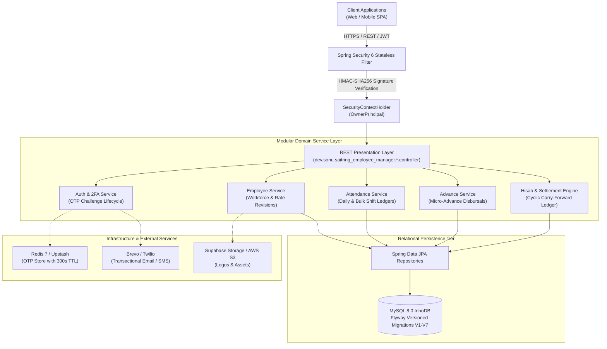

<div align="center">

# 🏗️ Saitring Employee Manager (SEMA)
### *Modular Multi-Tenant SaaS Backend for Scaffolding, Shuttering & Formwork Enterprises*

[](https://openjdk.org/)
[](https://spring.io/projects/spring-boot)
[](https://www.mysql.com/)
[](https://redis.io/)
[](https://flywaydb.org/)
[](https://spring.io/projects/spring-security)
[](#testing--verification-suite)

<p align="center">
  <a href="#system-architecture">Architecture</a> •
  <a href="#multi-tenancy-isolation-model">Multi-Tenancy</a> •
  <a href="#financial-settlement--hisab-engine">Settlement Engine</a> •
  <a href="#database-engineering--schema-lineage">Database & Flyway</a> •
  <a href="#rest-api-contract-reference">API Catalog</a> •
  <a href="#quickstart--local-development">Quickstart</a> •
  <a href="#engineering-documentation-index">Documentation Suite</a>
</p>

---

</div>

## 📌 Executive Overview

**Saitring Employee Manager (SEMA)** is a production-engineered, multi-tenant enterprise backend engineered to automate workforce administration, daily attendance logging, continuous micro-advances, and monthly financial settlement (*Hisab*) for the scaffolding, shuttering, and construction formwork (*saitring*) sector.

### The Construction Domain Challenge
Traditional enterprise payroll software fails in construction and shuttering businesses due to high workforce fluidity:
1. **Irregular Shift Units**: Daily worker shifts are logged in fractional units—`PRESENT` ($1.0$), `HALF_DAY` ($0.5$), and `ABSENT` ($0.0$).
2. **Volatile Wage Schedules**: Daily wage rates are frequently revised mid-tenure based on site role progression, requiring temporal wage rate resolution.
3. **Continuous Advance Disbursements**: Workers routinely take ad-hoc cash advances throughout the month to cover subsistence and transit expenses.
4. **Cyclic Multi-Month Settlements**: Month-end reconciliation (*Hisab*) must offset running advances against wage earnings, accommodate partial payouts or excess advances, and automatically propagate remaining carry-forward debit/credit balances across future billing cycles.

---

## 🏛️ System Architecture

SEMA is built on a clean, decoupled modular layered architecture enforcing unidirectional dependency boundaries:

$$\text{Presentation Layer (REST Controllers)} \longrightarrow \text{Domain Service Layer} \longrightarrow \text{Persistence Layer (Spring Data JPA)} \longrightarrow \text{MySQL 8}$$



### Module Package Layout
```
dev.sonu.saitring_employee_manager/
├── auth/                      # 2FA Dynamic OTP Authentication & Challenge Management
├── owner/                     # Tenant Profile Management & Branding
├── employee/                  # Multi-Tenant Workforce Master & Temporal Wage History
├── attendance/                # Multi-Tenant Daily & Bulk Attendance Register Ledger
├── advance/                   # Multi-Tenant Running Advance Money Ledger
├── hisab/                     # Monthly Running Hisab & Multi-Month Settlement Engine
├── common/                    # Cross-cutting Config, Exception Handling, Brevo/Twilio & S3/Supabase Storage
└── security/                  # Spring Security 6, JJWT 0.12 Provider, OwnerPrincipal Context
```

---

## 🔒 Multi-Tenancy Isolation Model

SEMA implements **Row-Level Discriminator Partitioning** within a unified schema. Isolation is protected by defensive architectural invariants:

* **Zero-Trust Client Identity**: Tenant identity (`ownerId`) is extracted exclusively from the authenticated JWT security context (`@AuthenticationPrincipal OwnerPrincipal principal`). Clients can **never** pass an `ownerId` in request bodies or query paths.
* **Anti-Enumeration Data Masking (IDOR Defense)**: Accessing an entity belonging to another tenant yields `404 Not Found` (rather than `403 Forbidden`). This conceals the existence of foreign tenant records.
* **Tenant-Scoped Database Constraints**:
  * Mobile numbers are unique **per owner tenant** (`UNIQUE(owner_id, mobile_number)`). Two independent contractors can employ workers who share a mobile number without conflict.
  * Attendance is strictly unique per `(owner_id, employee_id, attendance_date)`.
  * Hisab is uniquely constrained per `(owner_id, employee_id, hisab_month)`.

---

## 🧮 Financial Settlement & Hisab Engine

The monthly settlement engine in [`HisabServiceImpl.java`](file:///d:/DOWNLOADS/freelance-projects/saitring-employee-manager/src/main/java/dev/sonu/saitring_employee_manager/hisab/service/HisabServiceImpl.java) computes wages, deductions, and cyclic carry-forwards with exact `BigDecimal` half-up arithmetic:

```
┌───────────────────────────────────────────────────────────────────────────────────────────────┐
│                               MONTHLY HISAB CALCULATION MATRIX                                │
├───────────────────────────────────────────────────────────────────────────────────────────────┤
│                                                                                               │
│   1. Effective Days (E):                                                                      │
│          E = Full Days + (0.5 * Half Days)                                                    │
│                                                                                               │
│   2. Effective Wage Rate (R):                                                                 │
│          R = Latest rate from 'employee_rate_history' where effective_from <= monthEndDate    │
│                                                                                               │
│   3. Total Gross Earnings (W):                                                                │
│          W = round(E * R)                                                                     │
│                                                                                               │
│   4. Opening Balance (O):                                                                     │
│          O = Prior settled month carry_forward (default: 0.00)                                │
│                                                                                               │
│   5. Net Advance Deductions (A_total):                                                        │
│          A_total = round(Month Advances - Opening Balance)                                    │
│                                                                                               │
│   6. Net Final Payable (F):                                                                   │
│          F = round(Gross Earnings - Net Advance Deductions)                                   │
│                                                                                               │
│   7. Settlement Clearance & Carry-Forward (C):                                                │
│          C = round(Final Payable - Actual Cash Settlement Disbursed)                          │
│                                                                                               │
└───────────────────────────────────────────────────────────────────────────────────────────────┘
```

### Multi-Month Cyclic Carry-Forward Example
| Month | Attendance ($E$) | Effective Rate ($R$) | Gross Wages ($W$) | Month Advances | Opening Bal ($O$) | Final Payable ($F$) | Paid Out ($S$) | Carry Forward ($C$) | Carry-Forward Nature |
|---|---|---|---|---|---|---|---|---|---|
| **Month 1** | $21.0\text{ days}$ | $\$500.00$ | $\$10,500.00$ | $\$3,000.00$ | $\$0.00$ | $\$7,500.00$ | $\$5,000.00$ | **$+\$2,500.00$** | Worker credit carried to Month 2 |
| **Month 2** | $24.0\text{ days}$ | $\$600.00$ | $\$14,400.00$ | $\$4,000.00$ | $+\$2,500.00$ | $\$12,900.00$ | $\$12,900.00$ | **$\$0.00$** | Fully cleared settlement |
| **Month 3** | $10.0\text{ days}$ | $\$600.00$ | $\$6,000.00$ | $\$8,000.00$ | $\$0.00$ | $-\$2,000.00$ | $\$0.00$ | **$-\$2,000.00$** | Worker advance debit carried to Month 4 |

---

## 🗄️ Database Engineering & Schema Lineage

The database is versioned via **Flyway** with strict validation (`spring.jpa.hibernate.ddl-auto=validate`).

### Flyway Migration Timeline
* [`V1__create_owners.sql`](file:///d:/DOWNLOADS/freelance-projects/saitring-employee-manager/src/main/resources/db/migration/V1__create_owners.sql): Creates `owners` tenant master table with unique natural keys (`email`, `phone_number`) and stable listing indexes.
* [`V2__create_employees.sql`](file:///d:/DOWNLOADS/freelance-projects/saitring-employee-manager/src/main/resources/db/migration/V2__create_employees.sql): Creates `employees` table with foreign key `ON DELETE CASCADE` and tenant-scoped mobile index `(owner_id, mobile_number)`.
* [`V3__create_attendance.sql`](file:///d:/DOWNLOADS/freelance-projects/saitring-employee-manager/src/main/resources/db/migration/V3__create_attendance.sql): Creates `attendance` table with unique constraint `(owner_id, employee_id, attendance_date)`.
* [`V4__create_advances.sql`](file:///d:/DOWNLOADS/freelance-projects/saitring-employee-manager/src/main/resources/db/migration/V4__create_advances.sql): Creates `advances` table with positive amount constraint (`CHECK (amount > 0)`) and running balance indexes.
* [`V5__create_hisab.sql`](file:///d:/DOWNLOADS/freelance-projects/saitring-employee-manager/src/main/resources/db/migration/V5__create_hisab.sql): Creates `monthly_hisab` table with unique month constraint `(owner_id, employee_id, hisab_month)`.
* [`V6__create_employee_rate_history.sql`](file:///d:/DOWNLOADS/freelance-projects/saitring-employee-manager/src/main/resources/db/migration/V6__create_employee_rate_history.sql): Creates `employee_rate_history` table for temporal wage rate versioning.
* [`V7__add_settlement_clearance_columns.sql`](file:///d:/DOWNLOADS/freelance-projects/saitring-employee-manager/src/main/resources/db/migration/V7__add_settlement_clearance_columns.sql): Adds `opening_balance`, `settlement_amount`, and `carry_forward` columns to `monthly_hisab`.

### Composite Indexing Optimization Table
All multi-tenant queries follow the **Leftmost Prefix Standard** (`owner_id` first):

| Table | Index Name | Columns | Query Purpose |
|---|---|---|---|
| `employees` | `uk_employees_owner_mobile` | `(owner_id, mobile_number)` | Unique worker mobile per tenant |
| `employees` | `idx_employees_owner_created_id` | `(owner_id, created_at, id)` | Keyset / deterministic pagination |
| `attendance` | `uk_attendance_owner_emp_date` | `(owner_id, employee_id, attendance_date)` | Daily shift uniqueness & upsertion |
| `attendance` | `idx_attendance_owner_emp_date` | `(owner_id, employee_id, attendance_date)` | Monthly grid rollups |
| `advances` | `idx_advances_owner_settled` | `(owner_id, is_settled)` | Organization-wide running advance tracking |
| `monthly_hisab` | `uk_monthly_hisab_owner_emp_month` | `(owner_id, employee_id, hisab_month)` | Single settlement enforcement |
| `employee_rate_history` | `idx_employee_rate_history_lookup` | `(owner_id, employee_id, effective_from DESC)` | **Covering Index**: Instant effective rate lookup |

---

## 📡 REST API Contract Reference

Interactive documentation is available at:
* **Swagger UI**: `http://localhost:8080/swagger-ui.html`
* **OpenAPI JSON**: `http://localhost:8080/v3/api-docs`

### 1. Authentication (Public)
| Method | Endpoint | Description |
|:---:|---|---|
| `POST` | `/api/v1/auth/register` | Register new owner tenant (supports `multipart/form-data` with logo or `JSON`) |
| `POST` | `/api/v1/auth/login` | Verify credentials and dispatch dynamic 6-digit 2FA OTP |
| `POST` | `/api/v1/auth/verify-otp` | Validate 2FA OTP challenge and acquire JWT Bearer Token |
| `POST` | `/api/v1/auth/resend-otp` | Resend fresh OTP with cooldown throttling |

### 2. Owner Profile (Bearer JWT Required)
| Method | Endpoint | Description |
|:---:|---|---|
| `GET` | `/api/v1/owners/profile` | Retrieve authenticated tenant organization profile |
| `PUT` | `/api/v1/owners/profile` | Update profile details and upload new organization logo |

### 3. Employee Workforce Management (Bearer JWT Required)
| Method | Endpoint | Description |
|:---:|---|---|
| `POST` | `/api/v1/employees` | Create employee (`employeeName`, `mobileNumber`, `dailyRate`, `joiningDate`) |
| `GET` | `/api/v1/employees` | Paginated roster search with name/phone filters and status scoping |
| `GET` | `/api/v1/employees/{id}` | Get worker details by ID (tenant-scoped) |
| `PUT` | `/api/v1/employees/{id}` | Update worker master attributes |
| `DELETE` | `/api/v1/employees/{id}` | Delete worker and cascade-delete records |
| `PATCH` | `/api/v1/employees/{id}/block` | Block employee; prevents future attendance and advances |
| `PATCH` | `/api/v1/employees/{id}/unblock` | Restore employee status to `ACTIVE` |
| `POST` | `/api/v1/employees/{id}/rates` | Log new wage rate revision (`dailyRate`, `effectiveFrom`, `note`) |
| `GET` | `/api/v1/employees/{id}/rates` | Paginated chronological wage revision history |

### 4. Attendance Management (Bearer JWT Required)
| Method | Endpoint | Description |
|:---:|---|---|
| `POST` | `/api/v1/attendance` | Mark or upsert single-day attendance (`PRESENT`, `HALF_DAY`, `ABSENT`) |
| `POST` | `/api/v1/attendance/bulk` | Mark bulk attendance for multiple workers in a single atomic transaction |
| `GET` | `/api/v1/attendance/{id}` | Get attendance record by ID |
| `PUT` | `/api/v1/attendance/{id}` | Update existing attendance status and note |
| `DELETE` | `/api/v1/attendance/{id}` | Delete attendance record |
| `GET` | `/api/v1/attendance/register?month=YYYY-MM&page=0&size=20` | **Paginated Monthly Attendance Grid**: Day 1..31 matrix with row summaries |
| `GET` | `/api/v1/attendance/summary/daily?date=YYYY-MM-DD` | Daily attendance roll call counts and worker status list |
| `GET` | `/api/v1/attendance/summary/monthly?month=YYYY-MM` | Monthly aggregate statistics and estimated wage liability |
| `GET` | `/api/v1/attendance/employee/{employeeId}?month=YYYY-MM` | Employee detailed monthly attendance breakdown |

### 5. Advance Money Management (Bearer JWT Required)
| Method | Endpoint | Description |
|:---:|---|---|
| `POST` | `/api/v1/advances` | Disburse advance cash (`employeeId`, `amount`, `advanceDate`, `note`) |
| `GET` | `/api/v1/advances/{id}` | Get advance transaction by ID |
| `PUT` | `/api/v1/advances/{id}` | Edit advance amount, date, or note |
| `DELETE` | `/api/v1/advances/{id}` | Delete advance record (`204 No Content`) |
| `GET` | `/api/v1/advances/register?month=YYYY-MM&page=0&size=20` | **Paginated Monthly Advance Register**: Month advances & running balances |
| `GET` | `/api/v1/advances/employee/{employeeId}?month=YYYY-MM&page=0&size=20` | Worker advance transaction ledger |
| `GET` | `/api/v1/advances/summary/monthly?month=YYYY-MM` | Monthly advance totals and overdue balances |
| `GET` | `/api/v1/advances/summary/running` | Organization-wide running advance balance and top advance holders |

### 6. Hisab & Monthly Settlement (Bearer JWT Required)
| Method | Endpoint | Description |
|:---:|---|---|
| `GET` | `/api/v1/hisab?month=YYYY-MM&page=0&size=20` | **Monthly Running Hisab Table**: Dynamic register showing full/half days, effective days, active rate, earnings, total advance deductions, and final money |
| `POST` | `/api/v1/hisab/settle` | **Settle Monthly Hisab**: Clears hisab, supports partial payout/excess carry-forward, and marks all month advances as `SETTLED` |
| `GET` | `/api/v1/hisab/employee/{employeeId}?page=0&size=12` | Worker historical monthly settlements and running advance balances |

---

## ⚡ Quickstart & Local Development

### Prerequisites
* **Java 21 LTS** or **Java 25**
* **Apache Maven 3.9+**
* **Docker & Docker Compose**

### 1. Start Infrastructure via Docker Compose
Start MySQL 8 and Redis with healthy container states:
```bash
docker compose up -d mysql redis
```

### 2. Configure Environment
Create `.env` from the provided template:
```bash
cp .env.example .env
```
Ensure your database credentials match `docker-compose.yml` (`saitring_db`, `root` / `rootpassword`).

### 3. Build & Run the Backend
```bash
mvn spring-boot:run
```
The server will start on port `8080` with Flyway automatically executing migrations `V1` through `V7`.

---

## 🧪 Testing & Verification Suite

The repository features comprehensive automated test coverage validating business calculations, multi-tenant boundaries, rate resolution, cyclic carry-forwards, and API controllers.

Run the entire test suite:
```bash
mvn test
```

### Verified Test Results
```
[INFO] -------------------------------------------------------
[INFO]  T E S T S
[INFO] -------------------------------------------------------
[INFO] Running dev.sonu.saitring_employee_manager.advance.AdvanceControllerApiTest (6 tests)
[INFO] Running dev.sonu.saitring_employee_manager.advance.AdvanceServiceTest (10 tests)
[INFO] Running dev.sonu.saitring_employee_manager.attendance.AttendanceControllerApiTest (7 tests)
[INFO] Running dev.sonu.saitring_employee_manager.attendance.AttendanceServiceTest (12 tests)
[INFO] Running dev.sonu.saitring_employee_manager.auth.AuthControllerApiTest (7 tests)
[INFO] Running dev.sonu.saitring_employee_manager.auth.AuthServiceTest (5 tests)
[INFO] Running dev.sonu.saitring_employee_manager.auth.OtpServiceTest (4 tests)
[INFO] Running dev.sonu.saitring_employee_manager.employee.EmployeeControllerApiTest (5 tests)
[INFO] Running dev.sonu.saitring_employee_manager.employee.EmployeeServiceTest (12 tests)
[INFO] Running dev.sonu.saitring_employee_manager.hisab.HisabControllerApiTest (8 tests)
[INFO] Running dev.sonu.saitring_employee_manager.hisab.HisabServiceTest (13 tests)
[INFO] Running dev.sonu.saitring_employee_manager.owner.OwnerServiceTest (4 tests)
[INFO] Running dev.sonu.saitring_employee_manager.security.JwtTokenProviderTest (2 tests)
[INFO] 
[INFO] Results:
[INFO] 
[INFO] Tests run: 99, Failures: 0, Errors: 0, Skipped: 0
[INFO] 
[INFO] ------------------------------------------------------------------------
[INFO] BUILD SUCCESS
[INFO] ------------------------------------------------------------------------
```

---

## 📚 Engineering Documentation Index

For exhaustive technical depth, consult the dedicated architecture specifications in the [`docs/`](file:///d:/DOWNLOADS/freelance-projects/saitring-employee-manager/docs) directory:

| Specification Document | Focus Area |
|---|---|
| [`docs/ARCHITECTURE.md`](file:///d:/DOWNLOADS/freelance-projects/saitring-employee-manager/docs/ARCHITECTURE.md) | Clean Architecture layers, Domain-Driven Design (DDD), Sequence diagrams, N+1 query elimination. |
| [`docs/SETTLEMENT_AND_CALCULATION_ENGINE.md`](file:///d:/DOWNLOADS/freelance-projects/saitring-employee-manager/docs/SETTLEMENT_AND_CALCULATION_ENGINE.md) | Mathematical formulation of Hisab, daily wage history resolution, partial clearance, and cyclic carry-forward. |
| [`docs/DATABASE_DESIGN.md`](file:///d:/DOWNLOADS/freelance-projects/saitring-employee-manager/docs/DATABASE_DESIGN.md) | Full Entity-Relationship schema, Flyway migrations V1–V7, composite indexing strategy, and connection pool sizing. |
| [`docs/API_SPECIFICATION.md`](file:///d:/DOWNLOADS/freelance-projects/saitring-employee-manager/docs/API_SPECIFICATION.md) | Comprehensive REST API contract, request/response JSON payloads, status codes, and error envelopes. |
| [`docs/SECURITY_AND_MULTI_TENANCY.md`](file:///d:/DOWNLOADS/freelance-projects/saitring-employee-manager/docs/SECURITY_AND_MULTI_TENANCY.md) | Row-level tenant partitioning, anti-enumeration IDOR prevention, 2FA OTP security, and JWT claims integrity. |
| [`docs/DEPLOYMENT_AND_OPERATIONS.md`](file:///d:/DOWNLOADS/freelance-projects/saitring-employee-manager/docs/DEPLOYMENT_AND_OPERATIONS.md) | Environment configuration variables, JVM tuning flags, HikariCP sizing, Docker deployment, and Actuator telemetry. |

---

<div align="center">
  <sub>Saitring Employee Manager &copy; 2026. Built with Clean Architecture, Spring Boot 3.4 & Java 21.</sub>
</div>
