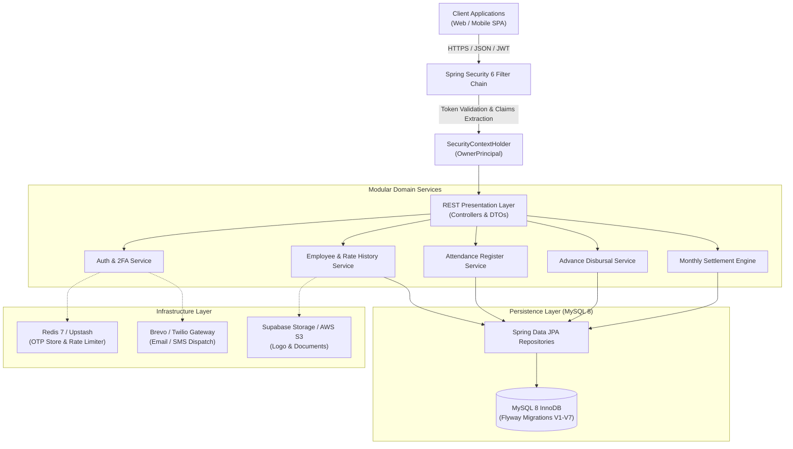
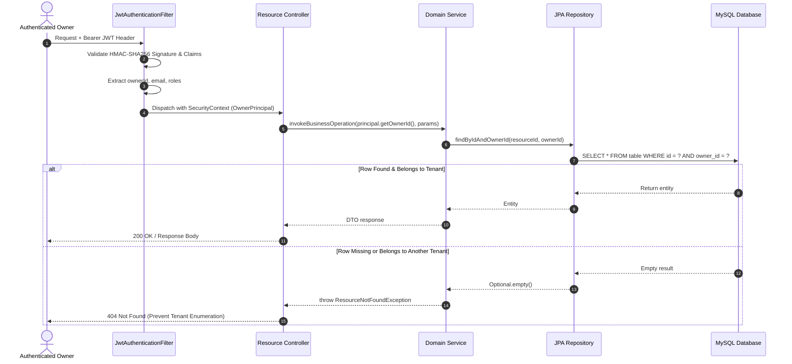
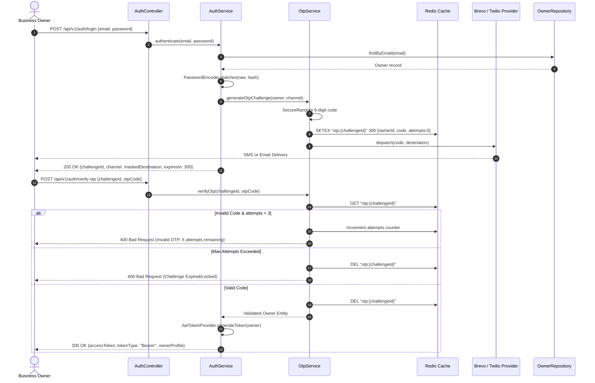
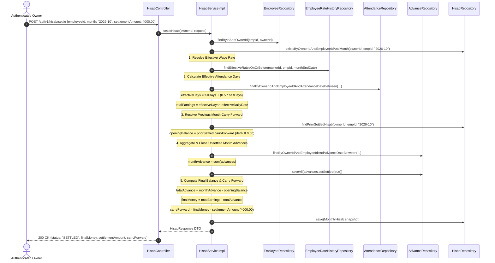

# System Architecture & Technical Design

## 1. Executive Domain Overview

The **Saitring Employee Manager (SEMA)** backend is a specialized, multi-tenant enterprise system designed for scaffolding, shuttering, and construction formwork (*saitring*) contractors. 

In formwork operations, workforce dynamics differ substantially from traditional corporate payroll:
- **Variable Wage Schedules**: Workers transition between different skill tiers (e.g., helpers, masters, fitters) where wage rates adjust frequently across calendar periods.
- **Continuous Cash Advances**: Workers regularly draw micro-advances throughout the month for living and travel expenses.
- **Irregular Work Shifts**: Daily attendance is split into full-days (`1.0`) and half-days (`0.5`).
- **Cyclic Settlement**: Month-end reconciliation (*Hisab*) must offset historical cash advances, compute payable earnings against historical rate schedules, support partial cash disbursements, and propagate remaining carry-forward debit/credit balances across subsequent billing cycles.



---

## 2. Clean Architecture & Layered Boundaries

The codebase strictly enforces unidirectional dependencies according to Clean Architecture principles:

$$\text{Presentation (REST)} \longrightarrow \text{Domain Service Layer} \longrightarrow \text{Data Access Repositories} \longrightarrow \text{Relational Database (JPA / SQL)}$$

### 2.1 Package Decomposition

```
dev.sonu.saitring_employee_manager/
│
├── auth/                      # Authentication & Dynamic 2FA Module
│   ├── controller/            # AuthController (REST public endpoints)
│   ├── dto/                   # RegisterRequest, LoginRequest, VerifyOtpRequest, AuthResponse
│   └── service/               # AuthService, OtpService, RedisOtpStorageService
│
├── owner/                     # Tenant Domain Module
│   ├── controller/            # OwnerController (Profile, Branding)
│   ├── dto/                   # OwnerResponse, UpdateOwnerProfileRequest
│   ├── entity/                # Owner JPA Entity, OwnerStatus, OwnerRole
│   ├── repository/            # OwnerRepository
│   └── service/               # OwnerService & Implementation
│
├── employee/                  # Multi-Tenant Employee & Temporal Wage Module
│   ├── controller/            # EmployeeController (CRUD, Status, Wage Rates)
│   ├── dto/                   # CreateEmployeeRequest, UpdateEmployeeRequest, RateRevisionRequest
│   ├── entity/                # Employee, EmployeeRateHistory, EmployeeStatus
│   ├── repository/            # EmployeeRepository, EmployeeRateHistoryRepository
│   └── service/               # EmployeeService & Implementation
│
├── attendance/                # Multi-Tenant Daily & Bulk Attendance Module
│   ├── controller/            # AttendanceController (Mark, Bulk, Grid, Summaries)
│   ├── dto/                   # MarkAttendanceRequest, BulkMarkAttendanceRequest, Summaries
│   ├── entity/                # Attendance JPA Entity, AttendanceStatus
│   ├── repository/            # AttendanceRepository
│   └── service/               # AttendanceService & Implementation
│
├── advance/                   # Multi-Tenant Advance Money Management Module
│   ├── controller/            # AdvanceController (Disburse, Ledger, Register, Summaries)
│   ├── dto/                   # CreateAdvanceRequest, UpdateAdvanceRequest, Summaries
│   ├── entity/                # Advance JPA Entity
│   ├── repository/            # AdvanceRepository
│   └── service/               # AdvanceService & Implementation
│
├── hisab/                     # Multi-Tenant Settlement & Calculation Engine Module
│   ├── controller/            # HisabController (Monthly Register, Settle, History)
│   ├── dto/                   # HisabTableRow, MonthlyHisabTableResponse, SettleHisabRequest
│   ├── entity/                # MonthlyHisab JPA Entity, HisabStatus, PaymentMode
│   ├── repository/            # HisabRepository
│   └── service/               # HisabService & Implementation
│
├── common/                    # Shared Infrastructure & Cross-Cutting Concerns
│   ├── config/                # SecurityConfig, OpenApiConfig, RedisConfig
│   ├── exception/             # GlobalExceptionHandler, Custom Exception Hierarchy
│   ├── notification/          # Brevo Email & Twilio SMS Service Clients
│   └── storage/               # Supabase Storage & S3 Storage Abstractions
│
└── security/                  # Spring Security 6 & JJWT Stateless Engine
    ├── JwtTokenProvider       # Token generation, signing, parsing, claims validation
    ├── JwtAuthenticationFilter# Per-request Authorization header filter
    ├── OwnerPrincipal         # Custom UserDetails implementation
    └── CustomUserDetailsService# UserDetails database resolution
```

---

## 3. Multi-Tenancy Isolation Architecture

SEMA implements a **Discriminator-Column (Row-Level) Multi-Tenancy Architecture** within a shared schema. This balances cost-efficiency, automated backups, and low operational overhead while ensuring airtight tenant isolation.

### 3.1 Security Principles
1. **Zero Client Trust for Tenant Keys**: The client is never allowed to specify the `ownerId` via request bodies or URL path parameters. The active `ownerId` is derived strictly from the cryptographically signed JWT claim and injected via `@AuthenticationPrincipal OwnerPrincipal principal`.
2. **Anti-Enumeration Data Masking**: If a tenant requests an entity ID belonging to another tenant (IDOR attempt), the system consistently responds with `404 Not Found` rather than `403 Forbidden`. This obscures the existence of foreign tenant entities.
3. **Database-Level Isolation Constraints**:
   - Every child entity (`employees`, `attendance`, `advances`, `monthly_hisab`, `employee_rate_history`) maintains a non-nullable foreign key `owner_id BIGINT NOT NULL REFERENCES owners(id) ON DELETE CASCADE`.
   - Business uniqueness rules are scoped per tenant:
     $$\text{UNIQUE}(\text{owner\_id}, \text{mobile\_number})$$
     $$\text{UNIQUE}(\text{owner\_id}, \text{employee\_id}, \text{attendance\_date})$$
     $$\text{UNIQUE}(\text{owner\_id}, \text{employee\_id}, \text{hisab\_month})$$



---

## 4. End-to-End Core Lifecycle Flows

### 4.1 Dynamic Two-Factor Authentication (2FA) Flow



---

### 4.2 Monthly Hisab Settlement & Carry-Forward Propagation Flow

The settlement engine executes a closed financial ledger update in an isolated transaction:



---

## 5. Performance Engineering & Caching Topology

### 5.1 N+1 Query Elimination in Tabular Registers
The monthly attendance register, advance register, and hisab tables query up to hundreds of workers simultaneously. Running separate queries per worker would generate severe $O(N)$ query loops.

SEMA implements **Batch-In Memory Grouping**:
1. Page of eligible employees is fetched using deterministic keyset/offset pagination:
   ```sql
   SELECT e FROM Employee e 
   WHERE e.owner.id = :ownerId AND e.joiningDate <= :monthEndDate 
   ORDER BY e.joiningDate ASC
   ```
2. Extracted `employeeIds` are fed into batch repository queries using SQL `IN (:employeeIds)`:
   - All attendance rows for the month in 1 query.
   - All advances for the month in 1 query.
   - Running advance sums in 1 query (`GROUP BY advance.employee.id`).
   - Prior month settlement snapshots in 1 query.
   - Effective wage rates in 1 query.
3. In-memory collation via Java `Collectors.groupingBy(a -> a.getEmployee().getId())` stitches the register rows in $O(N)$ time with fixed $O(1)$ database trips.

### 5.2 Redis Tiering
- **OTP Challenges**: Keyed as `otp:{challengeId}` with a 300-second absolute TTL.
- **Fail-Safe Resilience**: If Redis is offline during local test execution, the application context provides a mockable fallback while strictly requiring Redis for production deployments.
