# Database Engineering, Schema Architecture & Index Optimization

## 1. Relational Entity-Relationship Diagram

The SEMA persistence tier is built on **MySQL 8.0+** using the **InnoDB** storage engine with strict foreign key constraints, cascading deletions, and composite indexing designed for high-concurrency multi-tenant query workloads.

```mermaid
erDiagram
    OWNERS ||--o{ EMPLOYEES : "employs (1:N)"
    OWNERS ||--o{ ATTENDANCE : "manages (1:N)"
    OWNERS ||--o{ ADVANCES : "disburses (1:N)"
    OWNERS ||--o{ MONTHLY_HISAB : "settles (1:N)"
    OWNERS ||--o{ EMPLOYEE_RATE_HISTORY : "versions (1:N)"

    EMPLOYEES ||--o{ ATTENDANCE : "has records (1:N)"
    EMPLOYEES ||--o{ ADVANCES : "receives (1:N)"
    EMPLOYEES ||--o{ MONTHLY_HISAB : "accounted in (1:N)"
    EMPLOYEES ||--o{ EMPLOYEE_RATE_HISTORY : "rate revisions (1:N)"

    OWNERS {
        bigint id PK
        varchar owner_name
        varchar organization_name
        varchar email UK
        varchar phone_number UK
        varchar password_hash
        text address
        varchar logo_url
        varchar status
        varchar role
        timestamp created_at
        timestamp updated_at
    }

    EMPLOYEES {
        bigint id PK
        bigint owner_id FK
        varchar employee_name
        varchar mobile_number
        decimal daily_rate
        date joining_date
        varchar status
        timestamp created_at
        timestamp updated_at
    }

    ATTENDANCE {
        bigint id PK
        bigint owner_id FK
        bigint employee_id FK
        date attendance_date
        varchar status
        varchar note
        timestamp created_at
        timestamp updated_at
    }

    ADVANCES {
        bigint id PK
        bigint owner_id FK
        bigint employee_id FK
        decimal amount
        date advance_date
        varchar note
        boolean is_settled
        timestamp settled_at
        timestamp created_at
        timestamp updated_at
    }

    MONTHLY_HISAB {
        bigint id PK
        bigint owner_id FK
        bigint employee_id FK
        varchar hisab_month
        decimal daily_rate
        int full_days
        int half_days
        decimal effective_days
        decimal opening_balance
        decimal total_earnings
        decimal total_advance
        decimal final_money
        decimal settlement_amount
        decimal carry_forward
        varchar status
        varchar payment_mode
        timestamp settled_at
        varchar note
        timestamp created_at
        timestamp updated_at
    }

    EMPLOYEE_RATE_HISTORY {
        bigint id PK
        bigint owner_id FK
        bigint employee_id FK
        decimal daily_rate
        date effective_from
        varchar note
        timestamp created_at
        timestamp updated_at
    }
```

---

## 2. Flyway Migration Lineage

Database versioning is managed strictly via [Flyway](https://flywaydb.org/). Hibernate automatic schema alteration is explicitly forbidden in production (`spring.jpa.hibernate.ddl-auto=validate`).

| Migration File | Target Domain | Core Changes & Schema Mechanics |
|---|---|---|
| [`V1__create_owners.sql`](file:///d:/DOWNLOADS/freelance-projects/saitring-employee-manager/src/main/resources/db/migration/V1__create_owners.sql) | Tenant Account | Creates root `owners` tenant table with unique email, unique phone, and authentication indexing. |
| [`V2__create_employees.sql`](file:///d:/DOWNLOADS/freelance-projects/saitring-employee-manager/src/main/resources/db/migration/V2__create_employees.sql) | Workforce Master | Creates `employees` table with FK to `owners(id) ON DELETE CASCADE` and unique tenant mobile constraint `(owner_id, mobile_number)`. |
| [`V3__create_attendance.sql`](file:///d:/DOWNLOADS/freelance-projects/saitring-employee-manager/src/main/resources/db/migration/V3__create_attendance.sql) | Daily Work Shifts | Creates `attendance` table with unique constraint `(owner_id, employee_id, attendance_date)` and daily status indexing. |
| [`V4__create_advances.sql`](file:///d:/DOWNLOADS/freelance-projects/saitring-employee-manager/src/main/resources/db/migration/V4__create_advances.sql) | Cash Advances | Creates `advances` table with positive amount check constraint (`amount > 0`), settlement boolean flag, and running advance ledger indexes. |
| [`V5__create_hisab.sql`](file:///d:/DOWNLOADS/freelance-projects/saitring-employee-manager/src/main/resources/db/migration/V5__create_hisab.sql) | Monthly Settlement | Creates `monthly_hisab` table with unique month constraint `(owner_id, employee_id, hisab_month)` for audit snapshots. |
| [`V6__create_employee_rate_history.sql`](file:///d:/DOWNLOADS/freelance-projects/saitring-employee-manager/src/main/resources/db/migration/V6__create_employee_rate_history.sql) | Wage Versioning | Creates `employee_rate_history` table for temporal wage tracking; backfills initial wage records from existing employees. |
| [`V7__add_settlement_clearance_columns.sql`](file:///d:/DOWNLOADS/freelance-projects/saitring-employee-manager/src/main/resources/db/migration/V7__add_settlement_clearance_columns.sql) | Settlement Ledger | Extends `monthly_hisab` with `opening_balance`, `settlement_amount`, and `carry_forward` for cyclic multi-month carry-forward support. |

---

## 3. Schema Definitions & Integrity Constraints

### 3.1 `owners` Table
- **Primary Key**: `id BIGINT AUTO_INCREMENT`
- **Natural Keys**:
  - `email VARCHAR(100) NOT NULL UNIQUE`
  - `phone_number VARCHAR(20) NOT NULL UNIQUE`
- **Security**: `password_hash VARCHAR(255) NOT NULL` (BCrypt cost factor 12)
- **Status & Roles**: `status VARCHAR(30) DEFAULT 'ACTIVE'`, `role VARCHAR(30) DEFAULT 'ROLE_OWNER'`

### 3.2 `employees` Table
- **Foreign Key**: `owner_id BIGINT NOT NULL REFERENCES owners(id) ON DELETE CASCADE`
- **Tenant-Scoped Uniqueness**: `CONSTRAINT uk_employees_owner_mobile UNIQUE (owner_id, mobile_number)`
  > *Two separate business owners can independently employ workers with identical phone numbers without collision.*
- **Joining Date Invariant**: All advances and attendance records must satisfy:
  $$\text{event\_date} \ge \text{joining\_date}$$

### 3.3 `attendance` Table
- **Compound Uniqueness**: `CONSTRAINT uk_attendance_owner_emp_date UNIQUE (owner_id, employee_id, attendance_date)`
  > *Guarantees idempotency: marking attendance for the same worker on the same date upserts rather than duplicates.*
- **Status Enum**: `PRESENT`, `HALF_DAY`, `ABSENT`

### 3.4 `advances` Table
- **Positive Check**: `CONSTRAINT chk_advance_amount_positive CHECK (amount > 0)`
- **Settlement Tracking**: `is_settled BOOLEAN NOT NULL DEFAULT FALSE`, `settled_at TIMESTAMP NULL`

### 3.5 `monthly_hisab` Table
- **One Settlement Per Month**: `CONSTRAINT uk_monthly_hisab_owner_emp_month UNIQUE (owner_id, employee_id, hisab_month)`
- **Ledger Invariant**:
  $$\text{final\_money} = \text{total\_earnings} - \text{total\_advance}$$
  $$\text{carry\_forward} = \text{final\_money} - \text{settlement\_amount}$$

### 3.6 `employee_rate_history` Table
- **Check Invariant**: `CONSTRAINT chk_employee_rate_positive CHECK (daily_rate > 0)`
- **Temporal Effective Date**: `effective_from DATE NOT NULL`

---

## 4. Indexing Strategy & Query Optimization

All composite indexes strictly adhere to the **Leftmost Prefix Rule** with tenant partition keys placed first:

$$\text{Index Prefix} = (\text{owner\_id}, \text{equality\_column(s)}, \text{range\_or\_sort\_column})$$

### 4.1 Index Matrix

| Table | Index Name | Columns Indexed | Query Target / Optimization |
|---|---|---|---|
| `owners` | `uk_owners_email` | `(email)` | Fast auth lookup during login |
| `owners` | `uk_owners_phone_number` | `(phone_number)` | Fast auth & SMS 2FA lookup |
| `owners` | `idx_owners_created_at_id` | `(created_at, id)` | Stable deterministic pagination |
| `employees` | `uk_employees_owner_mobile` | `(owner_id, mobile_number)` | Tenant-scoped mobile conflict validation |
| `employees` | `idx_employees_owner_created_id` | `(owner_id, created_at, id)` | Paginated employee roster listing |
| `employees` | `idx_employees_owner_status` | `(owner_id, status)` | Filter active vs blocked employees |
| `employees` | `idx_employees_owner_name` | `(owner_id, employee_name)` | Employee name prefix auto-completion |
| `attendance` | `uk_attendance_owner_emp_date` | `(owner_id, employee_id, attendance_date)` | Unique daily shift upsertion |
| `attendance` | `idx_attendance_owner_date` | `(owner_id, attendance_date)` | Daily organization-wide attendance roll call |
| `attendance` | `idx_attendance_owner_emp_date` | `(owner_id, employee_id, attendance_date)` | Monthly worker attendance register grid |
| `attendance` | `idx_attendance_owner_status_date` | `(owner_id, status, attendance_date)` | Daily present/half-day/absent metrics |
| `advances` | `idx_advances_owner_date` | `(owner_id, advance_date)` | Monthly advance disbursement register |
| `advances` | `idx_advances_owner_emp` | `(owner_id, employee_id)` | Employee lifetime advance ledger |
| `advances` | `idx_advances_owner_emp_date` | `(owner_id, employee_id, advance_date)` | Employee periodic advance history |
| `advances` | `idx_advances_owner_settled` | `(owner_id, is_settled)` | Organization-wide unsettled running advance sum |
| `monthly_hisab` | `uk_monthly_hisab_owner_emp_month` | `(owner_id, employee_id, hisab_month)` | Idempotent single-settlement enforcement |
| `monthly_hisab` | `idx_monthly_hisab_owner_month` | `(owner_id, hisab_month)` | Monthly settlement register table retrieval |
| `monthly_hisab` | `idx_monthly_hisab_owner_emp` | `(owner_id, employee_id)` | Worker past hisab settlement history |
| `employee_rate_history`| `idx_employee_rate_history_lookup`| `(owner_id, employee_id, effective_from DESC)` | **Covering Index**: Instant $O(\log N)$ effective rate retrieval |
| `employee_rate_history`| `idx_employee_rate_history_owner` | `(owner_id)` | Tenant-wide rate catalog scan |

---

## 5. Production Database Safeguards

1. **Character Set**: `CHARACTER SET utf8mb4 COLLATE utf8mb4_unicode_ci` guarantees full emoji and multilingual support.
2. **Strict UTC Timestamps**: Database connections enforce `spring.jpa.properties.hibernate.jdbc.time_zone=UTC` to avoid server timezone drift.
3. **Connection Pool Sizing**:
   $$\text{Max Pool Size} = (\text{CPU Cores} \times 2) + \text{Disk Spindle Count}$$
   HikariCP is configured with connection leak detection and idle timeouts to prevent pool starvation.
