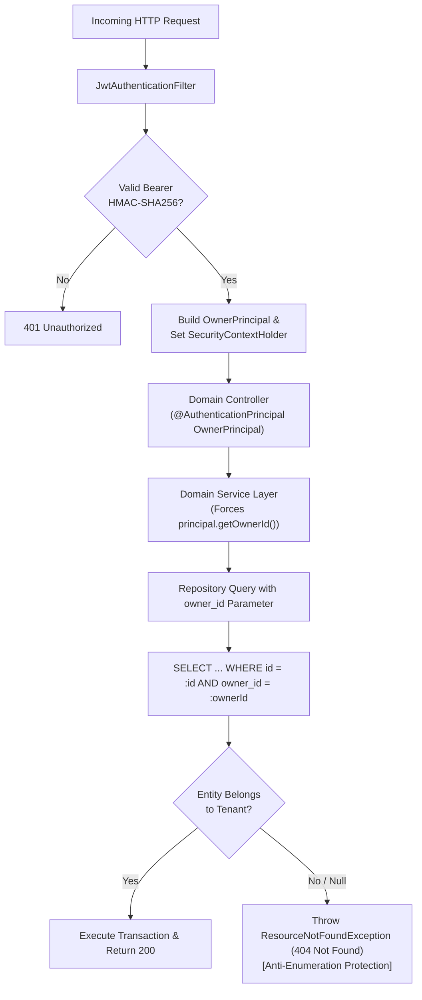

# Security Architecture, Threat Modeling & Multi-Tenancy Isolation

## 1. Multi-Tenancy Isolation Model

The core security requirement of SEMA is strict logical isolation between multiple construction business tenants sharing a unified database schema.



---

## 2. Threat Modeling & Defensive Controls

### 2.1 Insecure Direct Object Reference (IDOR) & Anti-Enumeration
- **Risk**: An attacker tenant modifies employee ID `101` in `/api/v1/employees/101` to probe whether other businesses employ a worker or view their financial hisab.
- **Defensive Implementation**:
  - The controller queries `employeeRepository.findByIdAndOwnerId(id, ownerId)`.
  - If the record does not exist or belongs to another tenant, the system throws `ResourceNotFoundException`.
  - Returning `404 Not Found` rather than `403 Forbidden` completely conceals whether the entity ID exists in another tenant's private ledger.

### 2.2 Broken Authentication & Dynamic 2FA Safeguards
- **Password Protection**: BCrypt hashing with salt rounds. Passwords are never serialized into DTOs or logs.
- **Dynamic OTP Architecture**:
  1. Generated using `java.security.SecureRandom` (cryptographically strong 6-digit integer).
  2. Stored in Redis with key pattern `otp:{challengeId}` and an absolute TTL of 300 seconds (5 minutes).
  3. Attempt Counter: Each failed verification attempt increments a counter in Redis. Upon 3 failed attempts, the key is evicted immediately, neutralizing brute-force attacks.
  4. Resend Cooldown: Redis enforces a 60-second cooldown timer between consecutive dispatch requests to prevent SMS/email flood abuse.

### 2.3 JWT Token Integrity
- **Algorithm**: HMAC-SHA256 (`Keys.hmacShaKeyFor(secret.getBytes())`).
- **Signature Verification**: Performed on every request by `JwtTokenProvider` via JJWT 0.12.
- **Claims Architecture**:
  - `sub`: Owner email address
  - `ownerId`: Long tenant identifier
  - `orgName`: Business organization name
  - `roles`: Authority grants (`ROLE_OWNER`)
  - `exp`: Configured token expiration epoch (default: 86,400 seconds / 24 hours)

### 2.4 SQL Injection Defense
- 100% of database access is mediated through Spring Data JPA and Hibernate ORM.
- All JPQL and native SQL queries use named parameter binding (`:ownerId`, `:employeeId`). No string concatenation is permitted in repository layers.

### 2.5 File Upload Validation (Logo & Assets)
- Multipart requests are capped at 5MB per file and 10MB per request in `application.properties`:
  ```properties
  spring.servlet.multipart.max-file-size=5MB
  spring.servlet.multipart.max-request-size=10MB
  ```
- Uploaded assets are routed to Supabase Storage or Amazon S3; no executable scripts or unvetted binaries are stored on the local application server filesystem.

---

## 3. Spring Security 6 Architecture & Filter Chain

SEMA utilizes Spring Security 6's component-based DSL (`SecurityFilterChain`):

```java
@Bean
public SecurityFilterChain securityFilterChain(HttpSecurity http) throws Exception {
    http
        .csrf(AbstractHttpConfigurer::disable)
        .cors(cors -> cors.configurationSource(corsConfigurationSource()))
        .sessionManagement(session -> session.sessionCreationPolicy(SessionCreationPolicy.STATELESS))
        .authorizeHttpRequests(auth -> auth
            .requestMatchers("/api/v1/auth/**").permitAll()
            .requestMatchers("/swagger-ui/**", "/swagger-ui.html", "/v3/api-docs/**").permitAll()
            .requestMatchers("/actuator/health", "/actuator/info").permitAll()
            .anyRequest().authenticated()
        )
        .authenticationProvider(authenticationProvider())
        .addFilterBefore(jwtAuthenticationFilter, UsernamePasswordAuthenticationFilter.class);

    return http.build();
}
```

---

## 4. Production Security Checklist

- [x] Stateless session management (`SessionCreationPolicy.STATELESS`).
- [x] Passwords hashed using BCrypt.
- [x] Two-Factor Authentication enforced on login.
- [x] Tenant context derived exclusively from JWT principal.
- [x] Anti-enumeration 404 responses for cross-tenant access.
- [x] Database level unique constraints per tenant.
- [x] Stack traces and error bindings disabled in HTTP error responses (`server.error.include-stacktrace=never`).
- [x] CORS whitelisting restricted to verified frontend domains.
